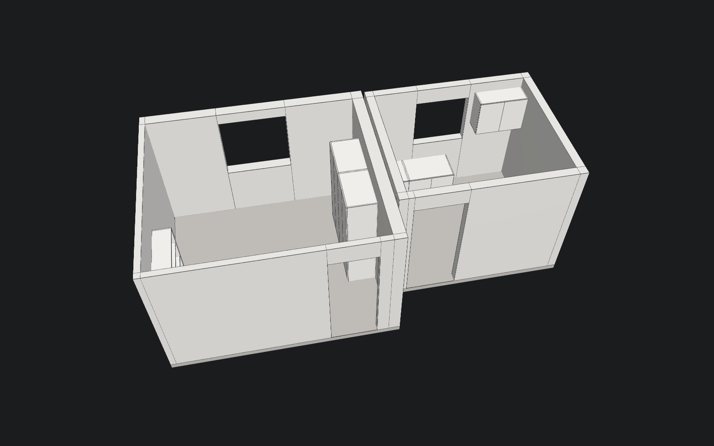
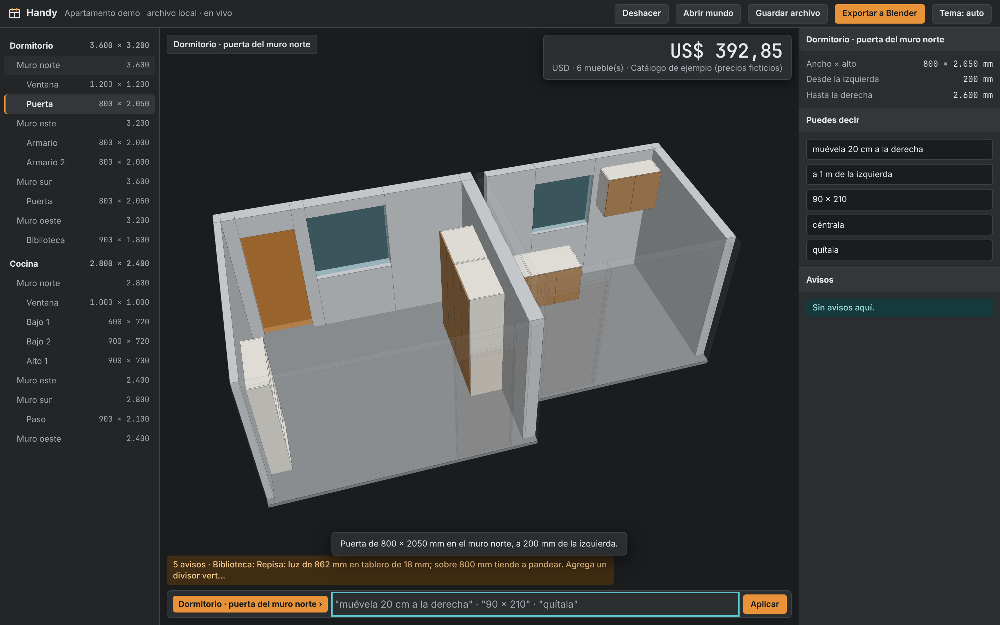

# Handy

**Handy** es tu taller virtual: un duplicado de tu casa donde tú y tu IA planifican muebles, pisos y estructuras sobre el espacio real. Es una herramienta open source para la persona que hace las cosas por sí misma: diseña tu cocina, tu closet o tu piso, manda a cortar en la tienda y ármalo en casa como un mueble de IKEA, sin tornillos a la vista ni perforaciones milimétricas. Calcula cuánto te va a costar con **precios de tiendas cercanas en tiempo real** y conecta **tu propia IA** (Claude, ChatGPT o un modelo local) para que te ayude a diseñar y decidir.

> Estado: **pre-alpha / planificación**. El motor (`@handy/core`) y el servidor MCP ya funcionan por línea de comandos. La app web y el ejecutable de escritorio están en diseño. Ver [docs/03-roadmap.md](docs/03-roadmap.md).

## La idea

Prototipos **rápidos y fieles** a lo que quieres, hechos en el navegador o en el ejecutable, que salen sin fricción a Blender y otros programas profesionales para presentarlos o fabricarlos. Un menú de tres secciones:

| Sección | Enfoque | Qué resuelve |
| --- | --- | --- |
| **Espacios** | interfaz y medidas de apartamentos, cuartos y casas | Dibujar el mapa del lugar con grosor de muros, puertas y ventanas; importar escaneos LiDAR del iPhone; **pisos**: despiece de cerámica o porcelanato, cajas, pega y boquilla; puntos eléctricos con inferencia de canalización; reglas de tuberías; estudio de luz solar. |
| **Muebles** | interfaz y medidas de muebles de madera, tablero, ladrillo y perfiles de acero | Gabinetes, closets, cocinas, escritorios en melamina; asadores y mesones de ladrillo. Sistema de unión según tus herramientas (perforación en la tienda o plantilla impresa), lista de corte, herrajes con su movimiento, cotización en tiempo real, decisiones como cajón o tapa con pistón, e instrucciones de armado. |
| **Objetos** | cosas pequeñas | Repuestos, accesorios y **plantillas de perforado** paramétricos, listos para imprimir en 3D en STL/3MF. |

Transversal a las tres: **simulación de esfuerzos** para saber si una repisa, un asador o un espacio aguanta la carga, **cotización** con precios locales, **exportación** a glTF/OBJ/STL/DXF/PDF, y un servidor [MCP](https://modelcontextprotocol.io) para que Claude, Claude Code, Cursor, Ollama u otras IAs del PC diseñen y coticen contigo.

Lee la visión en [docs/01-vision.md](docs/01-vision.md), la arquitectura en [docs/02-arquitectura.md](docs/02-arquitectura.md) y cada sección en [docs/modulos/](docs/modulos/).

## Prueba lo que ya existe

Requisitos: Node 20+ y pnpm 10+.

```bash
pnpm install
pnpm build
pnpm test
```

Diseña un armario de 800 x 2000 x 500 mm con 3 repisas, 2 puertas y zócalo, unido con minifix (sin tornillos visibles):

```bash
pnpm cli cabinet --width 800 --height 2000 --depth 500 --shelves 3 --doors 2 --plinth 80 --joinery minifix
```

Obtienes la lista de corte, los m² y tableros necesarios, avisos de diseño (pandeo de repisas, puertas demasiado anchas, uniones visibles) y una cotización con el catálogo de ejemplo. Añade `--wall-left` para simular un muro pegado al mueble y ver si la puerta choca al abrir. Agrega `--json` para obtener el modelo completo con posiciones 3D de cada pieza.

### Tu casa como mundo

Genera el mundo de ejemplo (dos habitaciones con muebles) y su modelo para Blender:

```bash
pnpm --filter @handy/core demo:world
```

Quedan `docs/ejemplos/apartamento-demo.world.json` y `docs/ejemplos/apartamento-demo.gltf`. Abre el segundo en Blender con File › Import › glTF 2.0.



### El visor: clic y di qué quieres

```bash
pnpm web
```

Abre http://localhost:5174. Verás tu mundo en 3D. **Haz clic en un muro, un mueble, una puerta o una ventana** y escribe abajo lo que quieres, en tus palabras:

| Seleccionas | Escribes |
| --- | --- |
| un muro | `pon una puerta de 80 x 205 a 2 m de la pared izquierda` · `ventana de 120 x 100 centrada, antepecho 110` · `armario de 800 x 2000 x 500 a 60 cm de la derecha con 2 puertas y 3 repisas` · `closet de 180 x 220 x 60 con 2 divisiones, barra y 3 cajones` · `cajonera de 80 x 90 x 50` · `grosor 20 cm` |
| un mueble | `ensancha 10 cm` · `muévelo 30 cm a la derecha` · `agrega una repisa` · `2 divisiones` · `3 cajones` · `con barra de colgar` · `sin tornillos a la vista` · `quítalo` |
| una puerta o ventana | `muévela 20 cm a la derecha` · `90 x 210` · `céntrala` · `quítala` |
| una habitación | `piso de porcelanato 60 x 60` · `piso de cerámica 45 x 45 trabado` · `junta 3` · `alto 2,6 m` |
| nada | `cocina de 2,8 x 2,4 m` |

Cada cambio se valida (si no cabe, no se aplica y te dice por qué), actualiza el precio de la esquina, se puede deshacer y se guarda en tu archivo de mundo. Si tu IA cambia el mundo por MCP, el visor se actualiza solo. Lo que el intérprete no entiende te lo deja listo para copiar a tu IA.



El botón **Despiece** entrega un documento imprimible para la tienda: cuántos tableros comprar, la lista de piezas con sus cantos y el plano de corte tablero por tablero. Hay un ejemplo en `docs/ejemplos/apartamento-demo-despiece.html`.

Para comprobar todo de una vez (compilar, tipos, pruebas del motor y pruebas en navegador real):

```bash
pnpm check
```

Los números sin unidad se leen como se habla en obra: menos de 10 son metros, menos de 300 centímetros, el resto milímetros. La respuesta siempre repite la medida en mm.

### Conectar Handy a Claude (MCP)

```bash
pnpm mcp
```

Configuración para Claude Desktop o Claude Code (`claude mcp add handy -- pnpm --dir /ruta/a/Handy mcp`):

```json
{
  "mcpServers": {
    "handy": {
      "command": "pnpm",
      "args": ["--dir", "/ruta/a/Handy", "mcp"],
      "env": { "HANDY_WORLD": "/ruta/a/mi-casa.world.json", "HANDY_CATALOG": "/ruta/a/mi-catalogo.json" }
    }
  }
}
```

Herramientas expuestas hoy: las del mundo (`world_create`, `world_describe`, `world_add_room`, `world_add_opening`, `world_free_runs`, `world_place_cabinet`, `world_update_item`, `world_command`, `world_remove_item`, `world_check`, `world_quote`, `world_cutplan`, `world_floor_plan`, `world_export_gltf`) y las de mueble suelto (`design_cabinet`, `cutlist`, `search_prices`, `check_collisions`). Con `HANDY_WORLD` eliges el archivo de tu mundo. Ver [docs/modulos/ia-mcp.md](docs/modulos/ia-mcp.md).

### Usar tus precios locales

Copia `packages/core/data/catalog-ejemplo.json`, pon los precios de tu ferretería o distribuidor de tableros y pásalo con `--catalog` o la variable `HANDY_CATALOG`. Los adaptadores a tiendas reales se describen en [docs/modulos/cotizacion.md](docs/modulos/cotizacion.md).

## Estructura del repositorio

```
Handy/
├── packages/core/        Motor: modelo, generadores, lista de corte, validaciones, cotización
├── apps/mcp-server/      Servidor MCP (stdio) para IAs
├── apps/web/             Visor web del mundo (three.js): clic para seleccionar y comandos en español
├── apps/desktop/         Ejecutable (Tauri) que empaqueta la web + API local  [en diseño]
└── docs/                 Visión, arquitectura, roadmap, módulos, decisiones (ADR), ejemplos, mocks de UI
```

## Contribuir

Lee [CONTRIBUTING.md](CONTRIBUTING.md). Los primeros temas abiertos están en el [roadmap](docs/03-roadmap.md) y en cada documento de módulo bajo "Preguntas abiertas". Especialmente útiles: catálogos de precios por país, medidas estándar y normativas locales, y modelos de repuestos imprimibles.

## Licencia

MIT. Ver [LICENSE](LICENSE).
