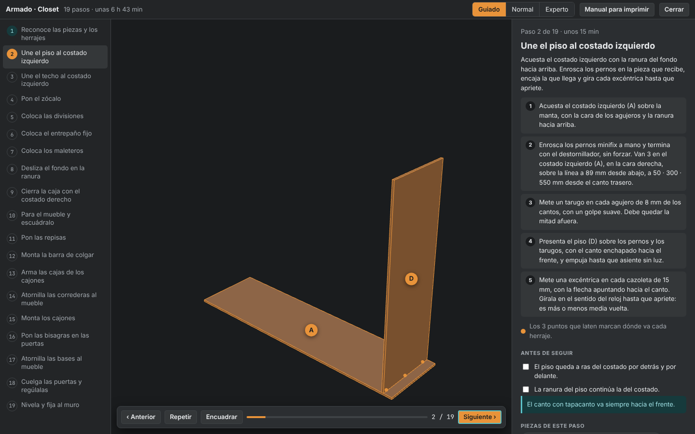

# Módulo: Armado paso a paso

Cuando el mueble está listo, Handy enseña a armarlo: en 3D dentro del visor, pieza por pieza, y en un manual para imprimir. Todo sale del modelo; no hay dibujos hechos a mano. Investigación y referencias en [../investigacion/herrajes-3d-y-armado.md](../investigacion/herrajes-3d-y-armado.md).

## Cómo se usa

- **En el visor:** selecciona un mueble y pulsa **Armado**, o escribe "¿cómo se arma?". Se abre el armado en 3D.
  - Flechas del teclado o los botones para avanzar y volver. **R** repite la animación. **Esc** cierra.
  - Las piezas del paso llegan a su sitio con animación y llevan su letra.
  - Los puntos que laten marcan dónde va cada herraje.
  - A la derecha: qué hacer, en orden, con medidas; qué comprobar antes de seguir; piezas, herrajes y herramientas del paso.
  - Se puede girar y acercar con el mouse. **Encuadrar** vuelve a la vista inicial.
  - **Manual para imprimir** descarga el manual al nivel elegido.
- **Desde tu IA:** `world_assembly { itemId, level }` devuelve los pasos con sus acciones y escribe el manual. `world_drilling { itemId }` devuelve el plano de perforación.
- **En código:** `buildAssemblyPlan(model, level)`, `assemblyScene(model, plan, paso)`, `assemblySvg`, `assemblyHtml(model, título, level)`, `computeJoints(model)`, `drillSheets(model)` en `@handy/core`.

Ejemplo de manual guiado: [`docs/ejemplos/apartamento-demo-armado.html`](../ejemplos/apartamento-demo-armado.html).

## Tres niveles de detalle

| Nivel | Para quién | Qué trae |
| --- | --- | --- |
| **Guiado** | quien arma su primer mueble | Una pieza por paso. Empieza por reconocer y marcar las piezas. Cada acción escrita, con cuántos herrajes van y a qué distancia de cada borde. Comprobaciones antes de seguir. Un closet completo son unos 19 pasos. |
| **Normal** | quien ya armó muebles de caja | Los pasos de un manual de mueble para armar: unos 9 para el mismo closet, con un resumen y dos comprobaciones. |
| **Experto** | quien tiene taller | Cuatro fases (caja, interior, frentes, nivelar) con el orden y las cantidades. |

Los tres niveles reparten exactamente las mismas piezas y los mismos herrajes. Cambiar de nivel en el visor conserva el punto del armado. El nivel elegido se recuerda.

## De dónde salen las medidas: uniones calculadas

`computeJoints(model)` recorre la geometría del mueble y encuentra cada sitio donde el canto de una pieza toca la cara de otra. De ahí salen tres cosas que antes eran estimaciones:

1. **La cantidad de herrajes.** Cada unión lleva herrajes según su largo: 1 hasta 120 mm, 2 hasta 350, 3 hasta 600, 4 si es más larga. La lista de herrajes del mueble es la suma de esas uniones.
2. **Dónde va cada uno.** A 50 mm de cada extremo de la unión y repartidos entre medias.
3. **Qué perforación pide** en cada pieza, según el sistema de unión:
   - minifix: perno en la cara de la pieza que recibe, paso del perno en el canto de la que llega, cazoleta de 15 mm para la excéntrica a 34 mm del canto (en la cara que menos se ve) y un tarugo al lado;
   - confirmat: agujero pasante en la cara y guía en el canto;
   - tarugos: dos por punto;
   - tornillo inclinado: el bolsillo en la cara oculta.

También se calculan los soportes de repisa (4 por repisa, a 50 mm del frente y del fondo), las bisagras (cazoleta de 35 mm en la puerta y base a 37 mm del canto del mueble, a las mismas alturas), el eje de cada corredera y los soportes de la barra.

## Plano de perforación

Al final del manual, y con `world_drilling`, hay un plano por pieza: la cara dibujada con sus perforaciones, y lo mismo en texto, agrupado por líneas de taladros:

> Perno minifix (Ø5 mm, 12 mm de fondo), en la cara derecha: línea a 89 mm desde abajo; taladros a 50 · 300 · 550 mm desde el canto trasero.

Sirve para pedir las piezas ya perforadas en la tienda, junto con el despiece, o para marcar en casa. Las piezas iguales con las mismas perforaciones se juntan en un solo plano.

## Orden de armado

Mueble de tablero: reconocer piezas, piso y techo al costado izquierdo acostado, zócalo, divisiones, entrepaños fijos, fondo por la ranura (antes de cerrar: después ya no entra), costado derecho, parar y escuadrar, repisas, barra, cajones (cajas, correderas al mueble, montaje), puertas (bisagras, bases, colgar y regular), nivelar y fijar al muro.

Estructura de tubo: revisar cortes, marcos laterales, travesaños largos, limpieza y pintura, cubierta, fijación al muro si es alta y angosta. El texto cambia según sea soldada o atornillada.

Los pasos de la caja se muestran con el mueble acostado sobre el costado izquierdo, que es como se arma de verdad.

## Límites actuales

- Las posiciones siguen reglas generales de taller, no la plantilla de una marca concreta de herraje. Antes de perforar correderas y bisagras, compara con la hoja del fabricante.
- No hay ampliaciones de detalle del herraje (la excéntrica girando) ni narración.
- Los cajones se muestran ya en su sitio desde que se arman sus cajas.
- El manual es HTML para imprimir desde el navegador; no se genera PDF directo.
- Los tiempos son estimaciones de taller casero.
- Las estructuras de tubo no tienen plano de perforación ni puntos de unión señalados.

## Siguientes pasos

- Exportar el plano de perforación en el formato que reciba la tienda.
- Plantillas imprimibles en 3D para perforar sin medir (sección Objetos).
- Ampliación por herraje con su movimiento.
- Mostrar el armado de todo un cuarto, mueble por mueble.
